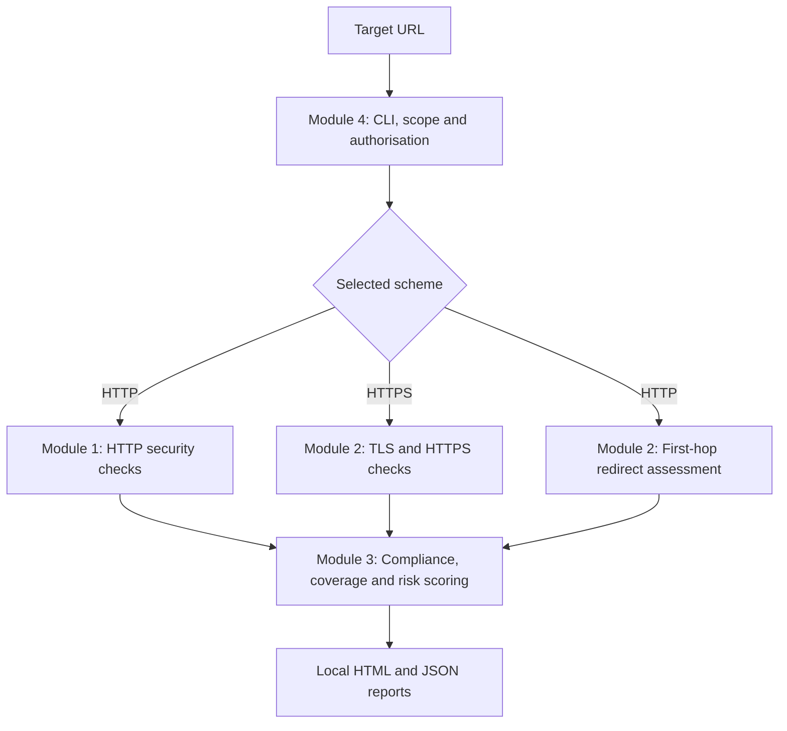

# WebGuard Audit

WebGuard Audit is a Python tool for a university ethical hacking project. It
audits one approved web origin at a time, scores observed findings against
project policies, and writes local reports with prioritised remediation.

| Module | Responsibility |
| --- | --- |
| [1. HTTP Security Auditor](docs/MODULE1_WRITEUP.md) | Analyses response headers, cookies, CSP, and disclosure evidence. |
| [2. TLS and HTTPS Security Auditor](docs/MODULE2_WRITEUP.md) | Checks verified connectivity, certificates, protocol versions, HTTPS availability, and first-hop redirects. |
| [3. Compliance and Reporting](docs/MODULE3_WRITEUP.md) | Adapts transport results, maps and deduplicates findings, tracks coverage, scores risk, and generates reports. |
| 4. CLI and Ethical Safeguards | Validates the origin, prompts for authorisation, binds network operations to the approved peer, and runs the audit plan. |

## Attack category and ethical hacking lifecycle

**Attack category: Auditing.** WebGuard Audit performs configuration and
transport-security assessments, not exploitation.

| Lifecycle stage | Tool contribution |
| --- | --- |
| Planning and authorisation | Confirm the permitted origin and obtain explicit permission for each invocation. |
| Reconnaissance | Collect limited HTTP response or TLS connection metadata from the approved local service. |
| Scanning and enumeration | Inspect HTTP headers, cookie attributes, CSP, disclosure evidence, certificates, modern TLS protocols and first-hop redirect intent according to the selected scheme. |
| Gaining access / exploitation | Not performed; exploitation is outside the tool's authorised scope. |
| Maintaining access | Not performed; no persistence or privilege escalation. |
| Covering tracks | Not performed; preserve audit evidence in labelled local reports. |
| Reporting and remediation | Map observed findings to project policies, distinguish incomplete coverage, score risk and recommend corrections. |

### Architecture



Dry runs stop after displaying the plan. Live operations use the authorised
transport; the diagram does not imply identical HTTP and HTTPS coverage.

## Setup

From the repository root in Windows PowerShell, create an environment for a new
checkout and install the [declared dependencies](requirements.txt). The verified
Windows profile used Python 3.14.5.

```powershell
python -m venv .venv
$Python = Resolve-Path .\.venv\Scripts\python.exe
& $Python -m pip install -r requirements.txt
```

The manifest lists `requests`, `rich`, `jinja2`, `cryptography`, `flask`,
`pytest`, and `ruff`. The proposed `cryptography>=42.0.0` minimum and adoption
of reporting schema version 1 as a team contract still require team agreement.

## CLI usage and scope

```powershell
& $Python -B main.py --help
& $Python -B main.py --version
& $Python -B main.py --target http://127.0.0.1:8000 --dry-run
& $Python -B main.py --target http://127.0.0.1:8000
& $Python -B main.py --target https://127.0.0.1:8443
```

Only test services you own or have explicit permission to audit. The CLI
allowlist contains exactly `http://127.0.0.1:8000` and
`https://127.0.0.1:8443`. Each invocation needs its own confirmation, including
dry-run. HTTP authorisation does not carry over to HTTPS. Other origins and
external websites are outside CLI scope. Targets may have a trailing slash.
Other paths, credentials, queries, and fragments are rejected.

| Origin | Operations |
| --- | --- |
| HTTP on port 8000 | Bounded `GET /` for HTTP security analysis and source-only `HEAD /` for first-hop redirect assessment. TLS certificate and protocol security are unassessed. |
| HTTPS on port 8443 | Verified TLS connectivity and certificate collection on one connection, exact TLS 1.2 and 1.3 probes, and one verified `HEAD /` for HTTPS response availability and first-hop redirect assessment. HTTPS content-header auditing is outside the current fetch contract. |

Dry-run prints the selected plan without opening network connections or
writing reports. The live CLI binds each operation to the approved scheme, host,
port, and numeric peer. It connects directly without DNS fallback or proxy
discovery. A redirect destination remains uncontacted and unverified. Legacy
TLS probing is disabled by default and has no CLI flag.

The live CLI uses a shared 20-second budget and applies remaining time at
transport checkpoints. Ctrl+C cancels when Python delivers the interrupt.
Cooperative checks cannot guarantee immediate interruption of Windows I/O
already blocked in the operating system.

## Legal disclaimer and ethical considerations

WebGuard Audit is intended only for authorised educational security auditing.
Users must comply with applicable law, including Malaysia's Computer Crimes
Act 1997 (Act 563). Do not use this tool for unauthorised access or testing.
Obtain explicit permission from the system owner before any audit; the CLI
confirmation is not a substitute for actual permission.

Scope checks, verified certificate and hostname validation, source-only
redirect checks, a bounded audit budget and dry-run mode reduce the risk of
unintended activity. Incomplete assessments are reported as such rather than
being treated as confirmed compliance.

## Rules of Engagement (RoE)

| Requirement | Rules |
| --- | --- |
| Authorised scope | Only the exact local origins `http://127.0.0.1:8000` and `https://127.0.0.1:8443` that the operator owns or has explicit permission to assess. |
| Time window | Agree the start and end of the laboratory or demonstration session with the system owner before testing. Run only inside that approved window; obtain fresh approval if it changes. The 20-second per-run audit budget is a separate technical limit, not permission to test. |
| Permitted techniques | Bounded HTTP GET and HEAD requests to the approved origin, verified TLS handshakes, certificate inspection, modern protocol probes and first-hop redirect classification. |
| Prohibited actions | External or out-of-scope scanning, exploitation, brute force, denial of service, persistence, data exfiltration, disabling certificate verification and following redirect destinations. |
| Emergency stop | Press Ctrl+C to cancel. Stop immediately if authorisation is withdrawn, scope is uncertain or unintended activity occurs. The CLI handles the interrupt with exit code 130 when delivered; blocked OS I/O may delay cancellation. |
| Data handling | Keep reports in the local `reports/` directory, restrict access to authorised participants, review/redact sensitive evidence before sharing and retain it only as agreed with the owner. Do not collect credentials or unnecessary personal data. |

## Responsible disclosure

- **Who:** Privately notify the authorised system owner or designated security
  team using their verified reporting channel; for issues in this project,
  contact the maintainers privately through an agreed channel.
- **When:** Report promptly after safe validation, within the agreed engagement
  schedule. Escalate urgent findings to the owner without further intrusive
  testing.
- **How:** Provide the affected approved origin, observed evidence, severity,
  impact, assessment limitations and remediation advice. Redact sensitive data,
  use an appropriate secure channel and coordinate any retest with the owner.
- **Confidentiality:** Do not post sensitive findings publicly, share credentials
  or extend testing without permission. Agree disclosure timing and retention
  with the owner; respect applicable law.

## Reports and exit codes

Live audits print the paths to local JSON and HTML files in `reports/`, relative
to the working directory. Incomplete observations can still yield useful
findings. Read coverage and policy status alongside the risk score. A low
score alone does not establish compliance, and a completed first-hop check
does not verify its destination.

| Code | Meaning |
| --- | --- |
| 0 | Confirmed dry-run, or live audit with complete recorded coverage. |
| 1 | Invalid or out-of-scope target, denied authorisation, or a completed run that wrote partial reports. |
| 2 | Invalid command-line arguments. |
| 130 | Ctrl+C reached the CLI interrupt handler. |

The default HTTPS plan leaves legacy versions unprobed. Current coverage rules
therefore mark the protocol assessment incomplete even if both modern probes
succeed, and the CLI can exit 1 after saving useful reports.

## Local demonstration

Start the deliberately weak HTTP fixture in one terminal, run the HTTP CLI
command above in another, then stop the fixture with Ctrl+C.

```powershell
& $Python -B -m demo.serve
```

The HTTP fixture handles GET. Its inherited HEAD response is 501, which
provides an observed non-redirect response. Use a controlled HEAD-capable
fixture for the separate redirect confinement scenario.

The standalone Member 2 demo starts its own dynamic loopback listeners and
takes no target arguments. A trusted **integrated** HTTPS demo instead needs a
listener on `127.0.0.1:8443`, a leaf certificate with IP SAN `127.0.0.1`, and a
temporary CA loaded only in the test context. The ordinary CLI has no CA flag
and keeps default certificate trust and hostname verification.
[Standalone demo and trust setup](docs/MODULE2_WRITEUP.md#standalone-loopback-demo)

Step 46C repeated the approved loopback demonstrations:

| Scenario | Exit | Observed result |
| --- | ---: | --- |
| HTTP on port 8000 | 0 | GET 200, first-hop HEAD 501, 14 findings, risk score 29, and `POL-009=NOT_CHECKED`. |
| Controlled HTTP 302 | 1 | The content fetch refused the redirect. The partial report retained first-hop evidence with `verification=not_attempted`. The destination was never resolved or contacted. |
| Trusted HTTPS on port 8443 | 1 | A temporary test-scoped CA enabled verified TLS 1.2 and 1.3. HEAD returned 200. One certificate expiry finding scored 4. Legacy versions remained unprobed, so coverage was partial and `POL-009=NOT_CHECKED`. Exit 1 was expected. |
| HTTPS with default trust | 1 | The certificate was rejected before any HTTP request. One deduplicated finding retained verification code 20, scored 7, and set `POL-009=FAIL`. |
| HTTP and HTTPS dry runs | 0 each | Both plans were displayed without network activity or report generation. |
| Authorisation denial and prompt cancellation | 1 and 130 | Both stopped before network activity or report generation. |

The four live scenarios produced JSON and HTML reports. They verified
mandatory safe adaptation and authorisation of the actual dialed peer
within the approved loopback scope.

## Verification

```powershell
& $Python -B tests\verify_member2.py
& $Python -B -m pytest --disable-plugin-autoload -p no:cacheprovider -o addopts= -q tests/test_scope.py tests/test_authorization.py tests/test_cli.py tests/test_integration_cli.py
& $Python -B -m ruff check --no-cache demo webguard tests main.py
& $Python -B -m ruff format --check --no-cache demo webguard tests main.py
```

Final Step 46C verification of `b47bca5b965ac80fd6a629489075e6638b009a42`
recorded **919 unique passing tests** across two non-overlapping guarded
partitions. The designated Member 2 runner passed 680 tests, and the remaining
integration partition passed 239. Both exited 0 with zero failures, skips,
xfails, or xpasses. All 40 required Member 2 loopback identities passed setup,
call, and teardown. All 900 previous test identities were preserved, with
19 additions.

The guarded runs used approved loopback endpoints only. The launcher confines
the parent and audited Python subprocesses at the Python level. OS-level
isolation is outside its scope. The historical Step 44.1 baseline remains
900 passing tests (680 Member 2 and 220 remaining integration). Its corrected
replay reserved a local non-listening port and passed all 220 remaining cases.
Evidence from the original launcher failure was retained.

## Final SonarQube Cloud analysis

The PR #6 analysis for the verified source commit passed the Quality Gate.
Security and Reliability on New Code both rated A. Both `pythonsecurity:S8703`
findings and the `python:S8495` finding were resolved as **Fixed**. Ten
maintainability-only issues and two deferred analysis warnings remain, with
zero security hotspots on New Code. Automatic Analysis runs without imported
coverage data. [PR #6 analysis](https://sonarcloud.io/dashboard?id=MollyWasGud_WebGuard-Audit&pullRequest=6)

## Historical SonarQube review

The main-branch snapshot at `cdae30e3` reported Security B with five Low findings,
Reliability A with zero open findings, and Maintainability A with 79 issues.
The Quality Gate was **Not computed**. The two configuration warnings concerned
`sonar.python.version` and `sonar.tests`. The five Low findings concern
intentional synthetic demo data, controlled loopback HTTP, and RFC 1918
private-network constants. These results belong to the historical snapshot.
