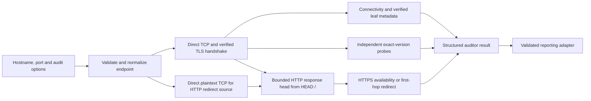

# Module 2: TLS and HTTPS Security Auditor

Module 2 measures transport security for a specified origin. It checks verified TLS connectivity, collects verified leaf certificate metadata, probes exact TLS versions, checks HTTPS response availability, and classifies the first redirect from an HTTP or HTTPS source. Member 1 analyzes HTTP security headers, CSP, cookies, and disclosure in supplied response evidence. Module 2 supplies complementary transport observations. The integration layer combines their observations for a single origin.

## Architecture



Validation accepts hostname strings or bare IP literals. DNS names are normalized to ASCII labels using IDNA. The code rejects malformed labels, ambiguous numeric IPv4 forms, URL syntax, whitespace, control characters, and IPv6 scope identifiers. The port must be a non-Boolean integer from 1 through 65535. The timeout must be a positive finite number in seconds, up to `(2**31 - 1) / 1000`. Standalone calls use per-operation timeouts. The CLI also applies a shared deadline through its bound transport. The lookup name and TLS verification identity are kept separate so an absolute DNS name can retain its trailing dot for lookup.

TLS connections use a fresh verified client context and collect handshake evidence only when available. The certificate auditor reads the verified leaf DER. The protocol auditor makes separate exact-version attempts under client policy. The HTTP auditors inspect a response head from one direct `HEAD /` request and retain only structured observations. The redirect auditor parses the destination origin without contacting it. Negotiation, response status, and redirect intent describe those specific observations.

## Setup and verified environment

The Step 36 Windows verification profile used Windows build 26300 with IPv4 loopback listeners, Python **3.14.5**, Python SSL backed by **OpenSSL 3.0.20**, **cryptography 50.0.2** with backend OpenSSL **4.0.3**, **pytest 9.2.0**, and **Ruff 0.17.6**.

From the repository root, use the project dependency manifest with a Python 3.14.5 environment for the verified profile.

```powershell
python --version
python -m venv .venv
.\.venv\Scripts\python.exe -m pip install -r requirements.txt
```

The [shared dependency manifest](../requirements.txt) lists `requests`, `rich`, `jinja2`, `cryptography`, `flask`, `pytest`, and `ruff` without version pins. Cryptography **42.0.0** introduced the UTC-aware certificate validity properties used by the auditor. This is the documented API floor. The proposed `cryptography>=42.0.0` declaration awaits team approval. The floor release and other platforms remain untested. [Cryptography 42.0.0 X.509 API](https://cryptography.io/en/42.0.0/x509/reference/#cryptography.x509.Certificate.not_valid_after_utc)

## Python API

The endpoint rules above apply to all five functions. Expected validation and operational failures are represented by the status or outcome and stage fields. Optional evidence can be `None`. Typed result dictionaries are intended for in-process use and can contain platform diagnostics or rejected input. Use the reporting adapter before emission. Each function accepts an optional keyword-only `transport: AuthorizedTransport | None = None`.

### TLS connectivity

```python
def audit_tls_connectivity(
    hostname: str, port: int = 443, *, timeout: float = 5.0,
    transport: AuthorizedTransport | None = None,
) -> TLSConnectivityResult:
```

Returns `hostname`, `port`, `status`, `failed_stage`, `tls_version`, `cipher_suite`, `error_message`, and `verify_code`, with optional `diagnostics`. Status is `ok`, `invalid_input`, `tls_setup_error`, `connection_error`, `timeout`, `certificate_verification_failed`, or `tls_handshake_error`. A failure can occur at `validation`, `tls_setup`, `connect`, or `handshake`. A verified handshake can succeed even when individual metadata reads fail. [TLS implementation](../webguard/auditors/tls.py)

### TLS certificate

```python
def audit_tls_certificate(
    hostname: str, port: int = 443, *, timeout: float = 5.0, warning_days: int = 30,
    transport: AuthorizedTransport | None = None,
) -> TLSCertificateAuditResult:
```

`warning_days` is a nonnegative, non-Boolean integer. The result has `connectivity`, `certificate_status`, `certificate`, and `certificate_error`. Invalid warning options return `invalid_options` without connecting. Failed connectivity leaves the certificate `not_collected`. DER, parser, or dependency failures can yield `metadata_error` while preserving connectivity evidence.

With `certificate_status="ok"`, the verified leaf includes `subject`, `issuer`, `serial_number`, `sans` (DNS or IP entries), `not_valid_before`, `not_valid_after`, `remaining_seconds`, `expiration_status`, and `sha256_fingerprint`. Validity timestamps are UTC-aware. Expiry is classified as `current`, `expiring_soon`, or `expired`. An expired certificate rejected by TLS may be visible only as a verification failure with no collected metadata.

### TLS protocols and ciphers

```python
def audit_tls_protocols(
    hostname: str, port: int = 443, *, timeout: float = 5.0, probe_legacy: bool = False,
    transport: AuthorizedTransport | None = None,
) -> TLSProtocolAuditResult:
```

Returns `target`, `status` (`ok` or `invalid_input`), `error_message`, `probes`, `not_probed`, and `recommendations`. It requests TLS 1.2 and 1.3 by default. Setting the Boolean `probe_legacy` enables attempts at TLS 1.0 and 1.1 only where runtime policy permits them. Otherwise legacy versions are listed in `not_probed`.

Each probe records `requested_version`, `outcome`, `evidence_code`, `negotiated_version`, `cipher_suite`, `secret_bits`, `failed_stage`, `error_message`, `verify_code`, and optional `diagnostics`. Outcomes are `confirmed_supported`, `client_restricted`, `server_rejected`, and `inconclusive`. Only a verified handshake at the requested version confirms support. A protocol-version alert supports `server_rejected` for that attempt and can precede peer authentication. Top-level `ok` means the probe results were produced. Confirmed legacy support can produce `disable_legacy_tls`. Confirmed TLS 1.2 paired with observed TLS 1.3 rejection can produce `review_tls_1_3`.

### HTTPS availability

```python
def audit_https_availability(
    hostname: str, port: int = 443, *, timeout: float = 5.0,
    transport: AuthorizedTransport | None = None,
) -> HTTPSAvailabilityResult:
```

Returns `target`, `outcome`, `http_status`, `is_redirect`, `failed_stage`, `verify_code`, `elapsed_ms`, and optional `diagnostics`. A valid final response status from 200 through 599 over verified TLS yields `available`. Application success is assessed separately. The supported redirect statuses are 300, 301, 302, 303, 307, and 308. Failure outcomes include `invalid_input`, `certificate_verification_failed`, `connection_refused`, `timeout`, `invalid_http_response`, `unsupported_http_response`, `tls_error`, and `transport_error`. `failed_stage` can distinguish `validation`, `tls_setup`, `connect`, `handshake`, `request`, and `response`. [HTTP implementation](../webguard/auditors/https.py)

### HTTP redirect assessment

```python
def audit_http_redirect(
    hostname: str,
    port: int | None = None,
    *,
    source_scheme: Literal["http", "https"] = "http",
    timeout: float = 5.0,
    transport: AuthorizedTransport | None = None,
) -> HTTPRedirectAuditResult:
```

`None` selects port 80 for HTTP and 443 for HTTPS. The result has `source` (scheme, hostname, port), `probe` (the HTTP outcome, status, stage, verification code, elapsed time and optional diagnostics), `redirect`, and `recommendations`. Input or probe failure leaves redirect assessment `not_evaluated`. A response can yield `no_redirect`, `unsupported_redirect_status`, `missing_location`, `empty_location`, `ambiguous_location`, `invalid_location`, `unsupported_scheme`, `same_scheme_redirect`, `upgrade`, or `downgrade`. The assessment contains `outcome`, `destination`, `same_host`, and `port_changed`. A parsed destination contains only the scheme, hostname, port, and `verification="not_attempted"`.

### Safe reporting adapter

```python
def to_safe_audit_report(kind: AuditKind, result: RawAuditResult) -> SafeAuditReport:
```

Pass the kind corresponding to the auditor that produced the result. The adapter accepts a producer result dictionary and returns a fresh report dictionary. It performs no network operations. Unknown kinds, malformed required structure, or contradictory validated evidence raise `ReportInputError` with the fixed message `Invalid audit report input`. Optional invalid values can be redacted while preserving valid evidence.

### Usage examples

These example calls assume controlled services you operate on IPv4 loopback, HTTP on port 8080 and HTTPS on port 8443. The HTTPS service needs a certificate trusted by the local runtime that matches `localhost`. Each call performs a separate audit. Use the corresponding pair individually when only one audit is needed.

```python
import json

from webguard.auditors.https import audit_http_redirect, audit_https_availability
from webguard.auditors.report_adapter import ReportInputError, to_safe_audit_report
from webguard.auditors.tls import (
    audit_tls_certificate,
    audit_tls_connectivity,
    audit_tls_protocols,
)

for kind, audit, port in (
    ("tls_connectivity", audit_tls_connectivity, 8443),
    ("tls_certificate", audit_tls_certificate, 8443),
    ("tls_protocols", audit_tls_protocols, 8443),
    ("https_availability", audit_https_availability, 8443),
    ("http_redirect", audit_http_redirect, 8080),
):
    try:
        report = to_safe_audit_report(kind, audit("localhost", port))
    except ReportInputError:
        print("Audit report rejected.")
        continue
    print(json.dumps(report, allow_nan=False))
```

## Safe reporting contract

Provisional schema version `1` contains `schema_version`, `kind`, `data`, and `issues`. The five kind strings are shown in the examples above. `data` is a field-by-field projection for that kind. `issues` contains schema field paths and codes (`invalid_value`, `unsafe_text`, or `value_too_long`) without the rejected values. The adapter uses bounded fields and collections, approved diagnostics and messages, and nullable optional evidence. It omits raw exception messages and raw redirect locations, including paths, query strings, fragments, and credentials. It rejects supported contradictions such as conflicting outcomes for one requested TLS version, overlap with `not_probed`, impossible negotiation evidence on rejection, and certificate failure attributed to a plaintext source.

For example, this synthetic result has the shape produced for a local TLS context setup failure. It is safe to exercise without a server.

```python
import json
from webguard.auditors.report_adapter import to_safe_audit_report

raw = {
    "hostname": "localhost",
    "port": 8443,
    "status": "tls_setup_error",
    "failed_stage": "tls_setup",
    "tls_version": None,
    "cipher_suite": None,
    "error_message": "Could not initialize the local TLS client context.",
    "verify_code": None,
}
report = to_safe_audit_report("tls_connectivity", raw)
assert report["schema_version"] == 1 and report["issues"] == []
json.dumps(report, allow_nan=False)
```

Consumers must apply output-context escaping, control which fields reach logs, and handle report rejection with a fixed diagnostic. Never fall back to logging or emitting raw results. Redaction is limited to known fields and patterns. Even accepted certificate text and hostnames can be sensitive. [Adapter implementation](../webguard/auditors/report_adapter.py)

## Standalone loopback demo

From the repository root, use the existing project environment.

```powershell
.\.venv\Scripts\python.exe -B -m demo.run_tls_demo
```

The demo starts its own HTTP and HTTPS listeners on dynamic ports at `127.0.0.1`. It creates a temporary CA and a one-hour leaf certificate for `localhost`, then adds that CA to fresh auditor contexts only within the demo process. It pins each demo TCP dial to its listener while retaining the requested TLS identity. The system trust store and parent environment are untouched.

- **TLS connectivity and certificates.** The output shows verified negotiation, the trusted leaf's near-expiry classification using a one-day warning window, and the rejection of the same leaf for `mismatch.invalid`. The tested runtime reports hostname-mismatch verification code `62`.
- **TLS protocol and cipher observations.** The demo prints the outcome and evidence code for each exact-version probe. The verified run confirmed TLS 1.2 and 1.3 and reported TLS 1.0 and 1.1 as client-restricted. A server-rejected result needs a protocol-version alert, while an inconclusive result leaves support undetermined. Each successful probe observes one negotiated cipher.
- **HTTPS availability and redirects.** The HTTPS listener records `HEAD /` and returns 200. Separate HTTP and HTTPS source responses produce 302 upgrade and downgrade intent. The demo checks both the source dial and the listener request logs, with zero destination dials. These observations cover response availability and first-hop intent only.
- **Safe reporting.** Seven genuine results go through the adapter before the demo prints a strict JSON summary. A synthetic HTTPS 200 result marked as a redirect is rejected with `Invalid audit report input`. The summary selects fields for presentation from the validated reports.

The demo accepts no target arguments and uses no external DNS or connections. It checks listener and worker shutdown and removes its temporary certificate files. Exit code `0` means the scenarios and cleanup checks passed, `1` indicates a demo failure, and `2` indicates a rejected argument. The verified profile is Windows IPv4 loopback. Demo-local endpoint pinning and the Python socket guard are scoped to this run. The integrated CLI uses its own fixed-origin authorization and transport. [Demo source](../demo/run_tls_demo.py)

## Verification

The accepted Step 36.4 baseline was **678 passing tests** with zero failures or skips and exit code **0**. It includes **40 exact required real loopback cases**, **201 reporting adapter tests**, and **23 runner regression tests**. These categories are included in the total. Ruff lint and format checks passed for all eight existing Member 2 Python files. The parent guard counted **129 loopback operations** and **zero non-loopback attempts**.

Run from the repository root using the designated Windows environment.

```powershell
.\.venv\Scripts\python.exe -B tests\verify_member2.py
```

The runner checks exact required pytest node IDs and requires passing setup, call, and teardown reports. Missing, skipped, failed, incomplete, or expected-failure results invalidate required coverage. It uses the default pytest prepend import mode, disables automatic plugin loading, and requires `PYTEST_ADDOPTS` and `PYTEST_PLUGINS` to be unset or empty. The Windows profile resolves test `localhost` to `127.0.0.1` and guards observed socket operations. It assumes trusted local Python, dependencies, startup hooks, and repository configuration. The built-in guard is scoped to the parent. The corrected launcher used in Steps 44.1 and 46C handles local reverse lookups without DNS and confines audited children as well. This is a Python-level network guard. OS-level isolation is outside its scope. [Verification runner](../tests/verify_member2.py)

## Security controls and limits

- **TLS policy.** The client loads default trust, verifies certificate identity, preserves runtime TLS policy, and creates contexts without honoring `SSLKEYLOGFILE`. On the verified runtime the TLS minimum was TLS 1.2, common-name fallback was enabled, and CRL checks were off. Results are relative to the runtime trust store and verification policy.
- **Evidence scope.** Fresh exact-version probes preserve inconclusive and client-restricted states. Each successful probe observes one cipher on one connection. Backend routing may vary between probes, so report each observation at the probe level.
- **HTTP scope.** The auditor sends `HEAD /` and examines bounded HTTP/1.0 or HTTP/1.1 response heads. Page contents, application behavior, and alternative paths or methods are outside that observation. Redirect assessment records first-hop intent. It performs no destination DNS, connection, or verification.
- **Timing and cleanup.** A timeout generally applies per operation. DNS, address fallback, and multiple probes can extend total elapsed time. Bounded cleanup diagnostics preserve the primary observation and identify failed cleanup attempts. A close error leaves resource release unverified. Cleanup internal to the runtime can be outside auditor visibility.
- **Portability and input trust.** The verified profile covers Windows IPv4 loopback. IPv6 listener behavior and alternative platforms and dependency versions remain unverified. Under pytest `importlib` mode, sibling test imports need an explicit test path. The `-o pythonpath=tests` workaround was checked only for collection and focused imports. Standalone verification does not establish safety for arbitrary or untrusted target input.

## Integration guide

### Member 3: Scoring and reporting

Pass typed `(kind, result)` pairs to `integrate_audit_results`. It applies
`to_safe_audit_report` before mapping, scoring or reporting. Adapter rejection
is recorded as incomplete coverage, with no finding and no fallback to raw
data. Direct consumers such as the standalone demo must adapt before emission.

Certificate failures are deduplicated by check ID and validated endpoint.
Distinct known verification codes are retained in sorted order in internal
evidence. Other mappings include certificate expiry, confirmed legacy
support, an advisory for TLS 1.3 rejection when TLS 1.2 was observed, and an
HTTPS-to-HTTP downgrade. A missing HTTP upgrade becomes a finding only with
the opt-in policy. Timeouts, client restrictions, and inconclusive outcomes
can leave coverage incomplete. See the [reporting contract](MODULE3_WRITEUP.md).

### Member 4: CLI and target authorization

The CLI allows only `http://127.0.0.1:8000` and `https://127.0.0.1:8443` with
explicit confirmation per invocation. It supplies an `AuthorizedTransport`
for the selected scheme, host, port, and numeric peer. This prevents resolver
fallback in the CLI path. It preserves the identity used for TLS verification
and the HTTP Host authority. The transport enforces a binding supplied by the
caller. The CLI owns the allowlist and confirmation. Standalone function
calls that omit the transport do not inherit CLI restrictions.

The HTTP plan uses the HTTP content fetch and a separate source-only redirect
probe. The HTTPS plan reuses the certificate check's connectivity evidence
and the redirect check's underlying HTTPS response observation. The CLI does
not issue extra calls to `audit_tls_connectivity` or
`audit_https_availability` for those observations. The protocol check uses
separate TLS 1.2 and 1.3 attempts. The CLI leaves legacy probing disabled and
does not audit HTTPS content headers or contact redirect destinations.

The transport applies the remaining shared deadline and checks for
cancellation at operation boundaries. It cannot guarantee immediate
interruption of blocking Windows I/O. The ordinary CLI uses default trust
and has no CA flag. Its fixed-port HTTPS demonstration needs a temporary CA
loaded in the test context and a leaf with an IP SAN for `127.0.0.1`.

## Presentation summary

The original standalone Windows run passed 678 tests. The historical Step
44.1 baseline passed 900 unique tests (680 Member 2 and 220 remaining
integration). Final Step 46C verification of
`b47bca5b965ac80fd6a629489075e6638b009a42` passed **919 unique tests** across
two non-overlapping guarded partitions (680 designated Member 2 and 239
remaining integration). Both exited 0 with zero failures, skips, xfails, or
xpasses. All 40 required loopback identities passed setup, call, and teardown.
All 900 previous identities were preserved, with 19 additions.

Within the approved loopback scope, the final demonstrations reconfirmed
P1-05, P1-06, P1-12, and P6-03. The HTTP GET and HEAD reached the authorized
peer. The controlled 302 retained first-hop evidence without resolving or
dialing the destination. A temporary test-scoped CA enabled verified TLS 1.2
and 1.3 and a successful HTTPS HEAD. Legacy versions remained unprobed, so
the trusted audit wrote partial reports and returned the intended exit 1.
With default trust, certificate verification stopped the HTTP request and
produced one deduplicated finding with verification code 20. See the
[final demonstration results](../README.md#local-demonstration) for exit
codes and policy outcomes. The proposed cryptography minimum and reporting
schema version 1 remain team decisions.
